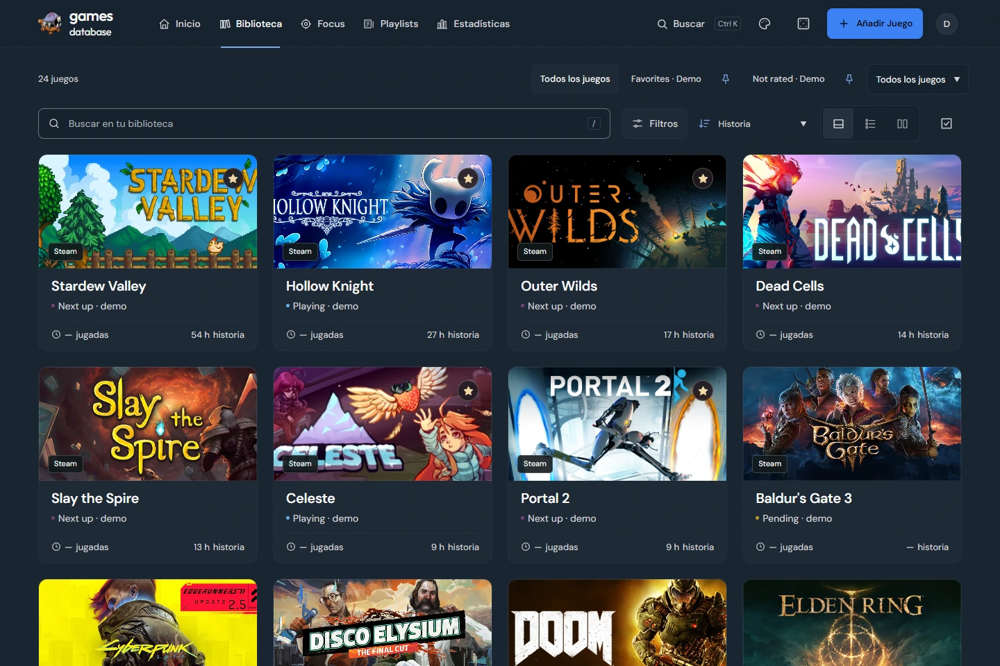
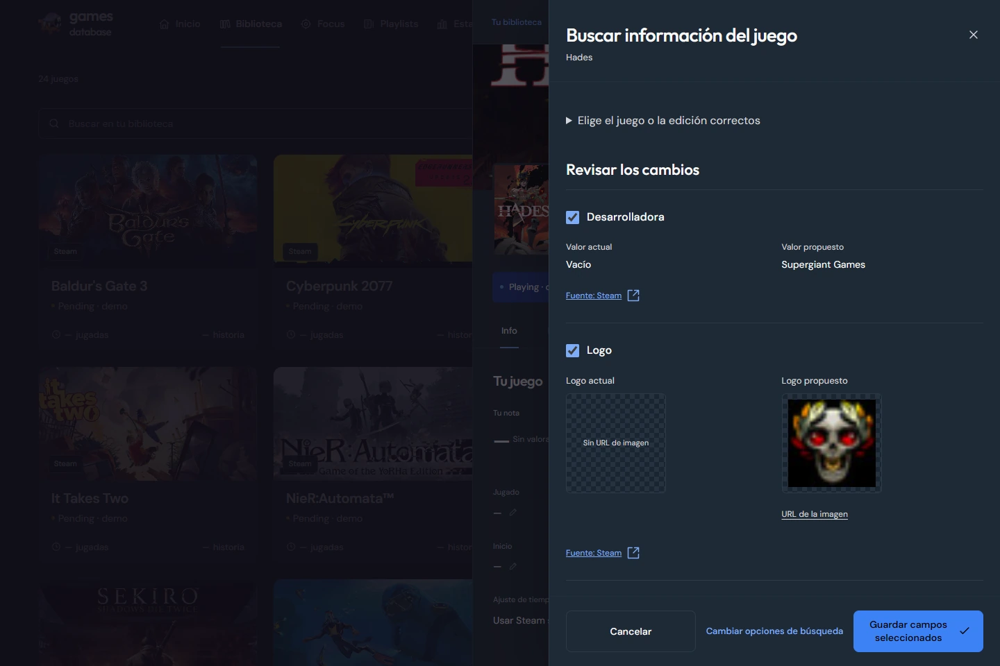

# Games Database API

[English](README.md) · [Español](README.es.md) · [Cliente web](https://github.com/David-H-Afonso/GamesDatabase.Front) · [Versiones](https://github.com/David-H-Afonso/GamesDatabase.Api/releases)

El backend de Games Database, desarrollado con ASP.NET Core, EF Core y SQLite.
Almacena la biblioteca de cada usuario y ofrece los servicios que utiliza el cliente
web: playlists, estadísticas, integración con Steam, metadatos y transferencia de datos.

## Funciones

- Autenticación JWT, administración de usuarios y bibliotecas y catálogos independientes.
- Búsqueda de juegos, filtros, vistas guardadas, playlists manuales y automáticas, y carpetas.
- Configuración de Inicio, Focus, registro de partidas y estadísticas de la colección.
- Importación desde Steam, seguimiento de logros y sugerencias de fechas para revisar.
- Datos de Steam y Wikidata, críticas con su fuente y estimaciones de HLTB a través
  de Deku Deals. Los lotes de autorrellenado se guardan en SQLite y pueden reanudarse.
- Herramientas CSV, JSON y ZIP, configuración de copias de seguridad e integración opcional con Household.

<details>
<summary>Ver el cliente web</summary>





</details>

[Créditos de las capturas](DOCS/SCREENSHOTS.es.md).

## Ejecutar en local

Instala el **SDK de .NET 10**. SQLite viene incluido, por lo que no hace falta un
servidor de base de datos. Node.js 22+ solo es necesario para las herramientas de
versionado del repositorio.

Antes de arrancar la API, configura una clave de firma privada, la ruta de la base
de datos y los callbacks indicados abajo. La [guía de instalación](DOCS/GETTING_STARTED.es.md)
explica la configuración y el primer acceso.

```sh
git clone https://github.com/David-H-Afonso/GamesDatabase.Api.git
cd GamesDatabase.Api
dotnet restore GamesDatabase.Api.sln
dotnet build GamesDatabase.Api.sln --configuration Release
dotnet run --project GamesDatabase.Api.csproj
```

Los perfiles de desarrollo usan HTTP en el puerto **5011** y HTTPS en el **7245**.
Swagger está disponible en `/swagger` en Development; `GET /health` muestra la
versión en ejecución. El contenedor escucha en el puerto **8080**.

En una instalación nueva, el arranque prepara la base y un administrador inicial. Establece su
contraseña antes de compartir el acceso y crea después las demás cuentas.
Cada usuario puede elegir el idioma de la interfaz; un administrador también puede
asignarlo al crear o editar la cuenta.

Las bases existentes se migran al arrancar. **Haz una copia de SQLite antes de
actualizar.** [Despliegue y recuperación](DOCS/DEPLOYMENT.es.md) explica las copias
de seguridad y la vuelta a una versión anterior.

## Configuración

| Variable | Uso |
| --- | --- |
| `GAMESDATABASE_DB_PATH` | Archivo de la base de datos SQLite |
| `JWT_SECRET_KEY` | Clave de firma privada, de al menos 32 caracteres |
| `JWT_ISSUER` / `JWT_AUDIENCE` | Emisor y audiencia de los tokens |
| `JWT_EXPIRATION_MINUTES` / `JWT_REFRESH_TOKEN_EXPIRATION_DAYS` | Duración de las sesiones |
| `CorsSettings__AllowedOrigins__0` | Origen permitido para el cliente web |
| `ASPNETCORE_URLS` | Direcciones y puertos de escucha |
| `ExportSettings__DefaultExportPath` | Directorio de exportación |
| `STEAM_API_KEY` | Clave del servidor para las funciones de jugador de Steam |
| `STEAMGRIDDB_API_KEY` | Clave opcional de imágenes en el servidor; también hay fuentes para consolas sin clave |
| `HOUSEHOLD_REDIRECT_URIS` | Callbacks exactos de Household, separados por comas |
| `HOUSEHOLD_CLIENT_ID` | Identificador de Household, si se cambia el predeterminado |

`HOUSEHOLD_REDIRECT_URIS` es obligatorio al arrancar, también en instalaciones
independientes. Si no utilizas Household, configura un callback reservado `.invalid`
como se indica en la [guía de instalación](DOCS/GETTING_STARTED.es.md).

Las claves JWT, las claves de Steam y los archivos de la base de datos deben
permanecer en el servidor, fuera de las variables del frontend y del repositorio.

## Resumen de la API

Inicia sesión con `POST /api/users/login` y envía el token recibido en
`Authorization: Bearer <token>` al consultar la biblioteca. Los endpoints de la
colección trabajan con los datos de la cuenta autenticada.

| Área | Rutas principales |
| --- | --- |
| Usuarios y sesiones | `/api/users`, `/api/users/login`, `/api/users/refresh` |
| Biblioteca | `/api/games`, `/api/gameviews`, `/api/playlists` |
| Inicio y estadísticas | `/api/home/config`, `/api/collection/statistics` |
| Revisión de información | `/api/games/{id}/metadata/preview`, `/api/games/{id}/metadata/apply` |
| Autorrellenado en segundo plano | `/api/metadata-autofill/jobs` |
| Steam | `/api/steam` |
| Guía inicial | `/api/onboarding` |

Para actualizar un juego basta con enviar los campos modificados. La revisión de
información devuelve una propuesta firmada; para aplicarla se envían su token y los
campos elegidos. La [referencia API](DOCS/FRONTEND_API_DOCUMENTATION.md) y los
[contratos de metadatos](DOCS/METADATA_REVIEW.es.md) detallan los cuerpos, las
respuestas y los ejemplos de uso.

## Desarrollo

```sh
dotnet test tests/GamesDatabase.Api.Tests/GamesDatabase.Api.Tests.csproj --configuration Release
```

Las pruebas de integración ejecutan la aplicación con bases SQLite aisladas y
respuestas de proveedores simuladas. [Contribuir](CONTRIBUTING.es.md) detalla las
comprobaciones, las migraciones y el flujo de versionado.

## Documentación y soporte

| Guía | Contenido |
| --- | --- |
| [Primeros pasos](DOCS/GETTING_STARTED.es.md) | Configuración, primera cuenta y arranque local |
| [Arquitectura](DOCS/ARCHITECTURE.es.md) | Servicios, persistencia y estructura de la aplicación |
| [Idioma de la cuenta](DOCS/ACCOUNT_LANGUAGE.es.md) | Asignación por el administrador, preferencias y tutorial |
| [API de colección (en inglés)](DOCS/COLLECTION_EXPERIENCE.md) | Inicio, playlists, estadísticas y recomendaciones |
| [Revisión de información](DOCS/METADATA_REVIEW.es.md) | Fuentes, propuestas firmadas y trabajos persistentes |
| [Fechas de Steam](DOCS/STEAM_DATES.es.md) | Fechas sugeridas, zonas horarias y revisión por campo |
| [Despliegue y recuperación](DOCS/DEPLOYMENT.es.md) | Contenedores, actualizaciones, copias de seguridad y vuelta atrás |

Si la API no arranca, comprueba primero la clave de firma y los callbacks.
Si el navegador no conecta, revisa la URL de la API y el origen permitido.
La [guía de despliegue](DOCS/DEPLOYMENT.es.md) también explica el proxy de imágenes
y el almacenamiento.

Puedes comunicar errores en [Issues](https://github.com/David-H-Afonso/GamesDatabase.Api/issues).
Los problemas de seguridad se notifican siguiendo [SECURITY.md](SECURITY.md).

## Licencia

[GPL-3.0-or-later](LICENSE.md). Las dependencias conservan sus propias licencias;
las imágenes de los juegos pertenecen a sus titulares.
