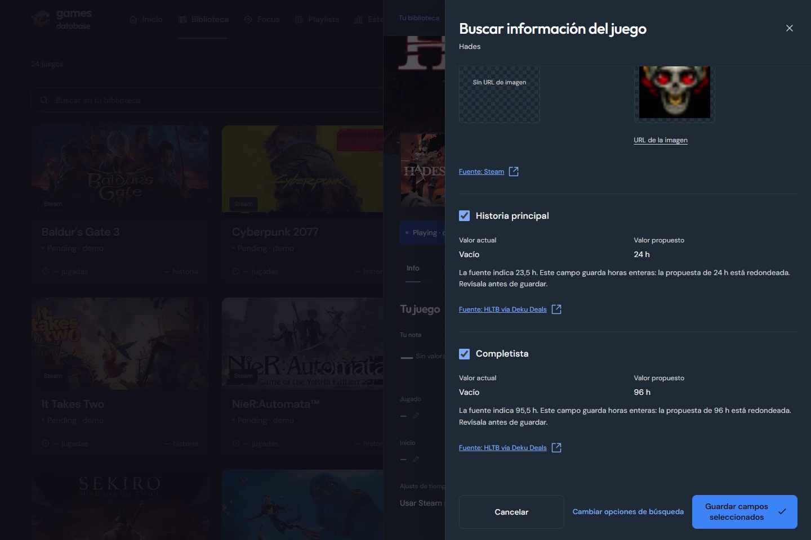
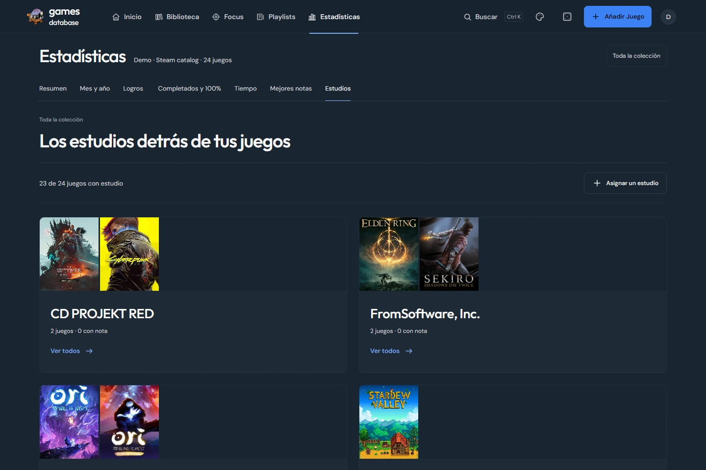

# Games Database API

[English](README.md) · [Español](README.es.md) · **Backend API** ·
[Web: English](https://github.com/David-H-Afonso/GamesDatabase.Front/blob/HEAD/README.md) /
[Español](https://github.com/David-H-Afonso/GamesDatabase.Front/blob/HEAD/README.es.md)

**La capa de datos propios e integraciones de Games Database.**

API ASP.NET Core/.NET 10 para bibliotecas personales: juegos, catálogos,
playlists, partidas, estadísticas, Steam, importaciones y recuperación. Cada
cuenta tiene su colección; el cliente no elige la identidad de otro usuario.

[Inicio rápido](#requisitos-e-inicio-rápido) · [Recorrido práctico](#de-la-api-a-la-biblioteca) ·
[Contratos](#contratos-api) · [Arquitectura](DOCS/ARCHITECTURE.es.md)


> Son capturas del **cliente web pareado**, no de un panel API ni de una cuenta pública
> de jugador. La demo independiente de 24 juegos utiliza datos/imágenes reales de Steam;
> estados, favoritos y listas ilustran organización. No se han copiado ni inventado
> logros de jugador, tiempo jugado, notas o fechas de partida.
> [Fuentes y alcance de las capturas](DOCS/SCREENSHOTS.es.md).

**Código y releases:** esta guía sigue el código del repositorio. El baseline
comprobado antes del seguimiento del 27 de noviembre era API **3.0.0** / Front **3.0.1**.
Consulta versión/SHA exactos en [releases API](https://github.com/David-H-Afonso/GamesDatabase.Api/releases)
y [releases Web](https://github.com/David-H-Afonso/GamesDatabase.Front/releases).
Una copia sin commit puede ir por delante de la última imagen; la documentación
no demuestra que una imagen antigua incluya los cambios posteriores de crítica/fechas/
chinchetas o seguridad.

## Funciones

- Autenticación JWT, administración de usuarios y datos/catálogos propios.
- CRUD, actualización parcial, búsqueda Unicode literal, filtros y vistas con dos plazas de chincheta propias.
- Playlists manuales/automáticas, carpetas, capacidad y orden atómico.
- Preferencias Inicio/GOTY con revisión y estadísticas de toda la colección.
- Conjuntos Steam base/DLC, completado conservado, jobs explícitos y revisión de fechas por campo.
- Candidatos de imágenes independientes y thumbnails SkiaSharp/WebP limitados.
- Metadatos Steam/Wikidata y estimaciones atribuidas desde Deku Deals público,
  con planes firmados/caducables y explicación de horas originales/redondeo.
- Guía opcional, vistas retenidas, juegos de ejemplo opt-in y limpieza revisada.
- Juego aleatorio propio y recomendaciones estables con cambio diario UTC.
- CSV/JSON/ZIP, backups y controles de sincronización de red.

## De la API a la biblioteca

### 1. Empieza por una cuenta y sus catálogos

Arranca la API con una base vacía/local elegida siguiendo la instalación inferior,
comprueba `GET /health` y abre `/swagger` en Development. Entra desde el cliente web
o `POST /api/users/login`. Usa su sesión bearer en las siguientes llamadas; no la
sustituyas por `X-User-Id` ni por IDs de otra cuenta.

Consulta `GET /api/gamestatus/active` y `GET /api/gameplatforms/active` para obtener
**tus** IDs de catálogo. Un alta manual puede ser tan pequeña como:

```http
POST /api/games
Authorization: Bearer <your-token>
Content-Type: application/json

{
  "name": "Portal 2",
  "statusId": 17,
  "creationRequestId": "1ca8ce95-7339-464b-a1b8-b3d5845ff845"
}
```

`17` es ilustrativo: usa un estado activo propio. Genera un UUID por fila nueva;
reintenta esa fila exacta con el mismo UUID/payload, no creando otro juego. El alta
compacta de la web conserva borradores y recibos por fila.


### 2. Añade catálogo sin importar progreso de jugadores

Usa **Rellenar información automáticamente** o pide
`POST /api/games/{id}/metadata/preview` con `overwrite`, `includeArtwork`,
`includeDurations`, `includeCritic`, `reviewVersion: 2` y una identidad revisada opcional. Examina `fields`, `matches` y
`notices`; envía solo los nombres de campos elegidos y el token del plan a
`POST /api/games/{id}/metadata/apply`. Consultar nunca guarda por sí solo.

El plan vincula cuenta, juego, timestamp de edición y caducidad de diez minutos.
Los datos generales usan Steam/Wikidata; historia/completista usa cifras HLTB
atribuidas publicadas en Deku Deals. `sourceHours` conserva precisión y la web
explica el valor propuesto en horas enteras. Ni estimaciones ni imágenes son progreso.

La crítica conserva el proveedor real: Metacritic de la edición Steam y después
Metacritic/OpenCritic atribuidos en Deku, explicando su ámbito de plataforma.
Reemplazar consulta grupos rellenados; confirmar coincidencias no inventa fechas ni
historial. Importar/sincronizar ya no etiqueta un porcentaje calculado de usuarios
como "SteamDB" y no reescribe notas existentes. Los lotes explícitos del Front usan
estas mismas rutas firmadas en secuencia, reintentando solo información y sin cambiar
vínculos ni sincronizar jugadores. [Revisión v2 y compatibilidad](DOCS/METADATA_REVIEW.es.md).




Usa `PUT /api/games/{id}` para cambios parciales normales. Omitir conserva; Logo/Hero/
Cover siguen independientes. Vincular Steam es otra decisión explícita, no un efecto
secundario de consultar metadatos públicos.

### 3. Reutiliza playlists, vistas y orígenes reales de Inicio

- `POST /api/playlists` crea listas manuales o automáticas por reglas; `maxLength`
  opcional limita altas sin eliminar miembros existentes.
- `POST /api/playlists/{id}/items` añade un juego propio. Agrupar/mover/ordenar es
  atómico. Focus es una playlist manual normal, no otra tabla de juegos.
- Las vistas guardan filtros/orden. `POST /api/gameviews/{id}/use` solo registra uso
  UTC; `POST /api/gameviews/{id}/pin` fija/desfija una de dos plazas propias. Una
  tercera devuelve `409` sin expulsar ninguna elección existente.
- `GET/PUT /api/home/config` y `POST /api/home/rows/resolve` configuran/resuelven filas
  desde listas, vistas, filtros, recomendaciones, Jugando o estadísticas. Quitar una
  fila no borra el origen; guardar usa la revisión compartida de preferencias.


Estanterías usa esas mismas listas manuales. Las recomendaciones son propias y
estables durante el día UTC; el aleatorio acepta toda la biblioteca o los IDs exactos
mostrados, sin ampliar silenciosamente una selección vacía/obsoleta.

### 4. Separa calendario, estimaciones y horas acumuladas

`GET /api/collection/statistics?year=2026&dateKind=finished` agrega todos los juegos y
Replays propios. `dateKind=started` usa inicios. `GET /api/collection/games` abre la
métrica paginada; GOTY es una elección explícita con revisión, no un premio generado.
Las estadísticas por estudio usan datos de catálogo guardados.



Steam aporta tiempo acumulado, no sesiones reconstruidas. El manual positivo lo
sustituye o se suma explícitamente; cero/vacío recupera Steam. Las horas estimadas
de historia/completista no declaran completado. Los conjuntos base/DLC y el 100%
estricto tienen políticas diferentes.

`GET /api/steam/date-suggestions?reviewVersion=2&timeZone=Europe%2FMadrid` ofrece
**referencias para campos vacíos**, no inicios/finales confirmados. Se elige cada
campo; Apply usa `expectedUpdatedAt` y devuelve recibos exactos/historial. Las fechas
existentes se conservan y sincronizar no desplaza un fin aceptado. Se filtran
sentinelas/futuros antes de elegir eventos. [Fechas Steam](DOCS/STEAM_DATES.es.md)
detalla zonas, alternativa de último logro, resultados parciales y clientes antiguos.

### 5. Ofrece guía sin apropiarte de los datos

`GET /api/onboarding` lee progreso/capacidades sin crear datos. La guía permite aceptar
seis juegos ficticios identificados y una playlist de ejemplo. Su
`POST /api/onboarding/views` crea **vistas normales retenidas**, sin depender de aceptar
juegos. Limpiar revisa el lote/timestamps, conserva editados por defecto y nunca borra
vistas normales ni miembros ajenos de playlists.


Los administradores pueden activar la guía al crear/editar usuarios. Cada cuenta
mantiene sus catálogos, vistas, listas, chinchetas y preferencias. La procedencia es
informativa, nunca permiso para acceder a otra cuenta o borrar sus registros.

### 6. Sincroniza y transfiere solo el ámbito previsto

Vincula un jugador Steam solo cuando quieras. `POST /api/steam/sync/jobs` inicia/deduplica
un job explícito; consulta estado propio en lugar de repetir POST. Los commits por juego
sobreviven al reinicio, no el estado temporal del job. Consultar Store es independiente
y no requiere pedir claves ajenas ni bibliotecas privadas.

La importación Steam y los ajustes `PATCH /api/games/bulk` tienen confirmaciones separadas.
El lote reserva transacción SQLite corta antes de leer y valida catálogos propios. Los
recibos no-op no falsean timestamps. Un bloqueo devuelve `503 databaseBusy` saneado con
`Retry-After: 1`, no un `400` engañoso de entrada inválida. Conserva una importación correcta
y reintenta solo ajustes pendientes si procede.

Usa CSV/JSON/ZIP según sus ámbitos documentados. Chinchetas, uso/orden de vistas y
preferencias admitidas se transfieren sin desalojar chinchetas del destino. La copia
SQLite completa sigue siendo necesaria para auth/historial/caché; no sustituyas datos
nuevos por un export antiguo para hacer pasar una prueba.

## Requisitos e inicio rápido

- **SDK .NET 10**; Microsoft/EF 10.0.15, Swashbuckle 10.3.1 y SkiaSharp 4.157.0.
- EF Core incluye SQLite; no hace falta otro servidor de base de datos.
- Node 22+ solo para herramientas de versión/release, no para ejecutar la API.

```sh
git clone https://github.com/David-H-Afonso/GamesDatabase.Api.git
cd GamesDatabase.Api
dotnet restore GamesDatabase.Api.sln
dotnet build GamesDatabase.Api.sln --configuration Release
dotnet test tests/GamesDatabase.Api.Tests/GamesDatabase.Api.Tests.csproj --configuration Release
```

Antes de arrancar, configura una clave de firma privada y la ruta de datos
explícitamente deseada. Sigue [Primeros pasos](DOCS/GETTING_STARTED.es.md): una
base existente requiere copia consistente antes del arranque y sus migraciones.

```sh
dotnet run --project GamesDatabase.Api.csproj
```

Los perfiles de desarrollo usan HTTP en el puerto 5011/HTTPS en el 7245 y `/swagger`.
El contenedor escucha en el puerto 8080. `/health` informa de la versión ejecutada.

## Instalación nueva y recuperación

Una SQLite realmente vacía se inicializa desde el modelo EF actual y registra
su baseline de migraciones. Una base con tablas/historial no se trata como nueva:
sus migraciones pendientes siguen siendo la referencia. Se crea el administrador
inicial y los catálogos, **no** juegos de ejemplo.

El administrador inicial no tiene contraseña para el bootstrap local. Establécela
antes de ampliar acceso. La guía es opcional al crear usuarios y se puede reactivar
sin añadir ejemplos ni cambiar su colección.

En una instancia existente, conserva la imagen anterior por digest, crea una
copia SQLite consistente con WAL y prueba una restauración aislada antes de
actualizar. Down puede borrar metadatos nuevos y no es un rollback automático
que conserve datos. Consulta [Despliegue y recuperación](DOCS/DEPLOYMENT.es.md).

## Configuración

| Nombre | Uso |
| --- | --- |
| `GAMESDATABASE_DB_PATH` | Archivo SQLite privado elegido |
| `JWT_SECRET_KEY` | Clave privada y robusta de firma |
| `JWT_ISSUER` / `JWT_AUDIENCE` | Emisor y audiencia |
| `JWT_EXPIRATION_MINUTES` / `JWT_REFRESH_TOKEN_EXPIRATION_DAYS` | Duración de tokens |
| `ExportSettings__DefaultExportPath` | Directorio privado de exportación |
| `CorsSettings__AllowedOrigins__0` | Origen explícito del navegador |
| `ASPNETCORE_URLS` | Direcciones/puertos de escucha |
| `STEAM_API_KEY` | Clave de servidor para datos de jugador Steam |
| `HOUSEHOLD_REDIRECT_URIS` | Lista obligatoria de callbacks exactos separados por comas, sin comodines |
| `HOUSEHOLD_CLIENT_ID` | Identificador si se cambia el cliente Household incorporado |

No expongas claves JWT/Steam/red en variables del Front. `.env*`, configuración
Development, bases y exports locales quedan fuera del repositorio y del contexto
Docker. Revisa TLS, orígenes, cabeceras y exposición reales, no solo valores Docker.

El arranque valida los callbacks también en una instalación independiente. Sin
Household, reserva un callback `.invalid` no enrutable según
[Primeros pasos](DOCS/GETTING_STARTED.es.md), sin ampliar permisos de redirección.

## Contratos API

- [Referencia para el Front](DOCS/FRONTEND_API_DOCUMENTATION.md)
- [Colección, Inicio, estadísticas y descubrimiento](DOCS/COLLECTION_EXPERIENCE.md)
- [Guía y metadatos revisados](DOCS/GUIDED_LIBRARY.md)
- [Conjuntos de logros Steam](DOCS/STEAM_ACHIEVEMENT_SETS.md)
- [Referencias de fechas Steam y ajustes concurrentes](DOCS/STEAM_DATES.es.md)
- [Runtime e imágenes](DOCS/RUNTIME_NET10.md)
- [Autorización Household](DOCS/HOUSEHOLD_INTEGRATION.md)

Inicio y GOTY comparten revisiones propias y devuelven 409 en conflicto. El tiempo
manual positivo sustituye a Steam o se suma con `manualPlaytimeIsAdditive=true`.
Cero/vacío recupera Steam; ambas fuentes siguen separadas. Completado no equivale a las horas
estimadas de historia/completista. Replays guarda registros, no sesiones inventadas.

El aleatorio acepta toda la biblioteca propia o IDs exactos mostrados. El uso de
vistas guarda `lastUsedAt` UTC sin editar su configuración. `creationRequestId`
opcional evita duplicar reintentos manuales mientras exista el registro asociado.

Consultar metadatos no guarda ni sincroniza jugadores. Aplicar acepta campos revisados
y rechaza timestamps antiguos. Steam Store depende de disponibilidad y Wikidata aporta
datos CC0. Las estimaciones atribuidas Deku Deals/HLTB son opcionales, no tiempos
garantizados; se muestran horas originales y redondeo. La falta de datos no borra campos.
[Guía y metadatos](DOCS/GUIDED_LIBRARY.md) detalla límites, elección, caducidad y rate limits.

## Comprobación

```sh
dotnet restore GamesDatabase.Api.sln -p:NuGetAuditMode=all -p:NuGetAuditLevel=moderate -warnaserror:NU1902,NU1903,NU1904
dotnet build GamesDatabase.Api.sln --configuration Release --no-restore
dotnet test tests/GamesDatabase.Api.Tests/GamesDatabase.Api.Tests.csproj --configuration Release --no-build
node --test scripts/versioning/core.test.mjs scripts/versioning/release.test.mjs
node scripts/versioning/cli.mjs check
```

Los tests usan bases `Testing` aisladas y respuestas de proveedores ficticias.
No necesitan datos/sesiones personales ni `.env.test` versionado. Los tests Windows
no sustituyen la prueba de imagen Linux y codificación nativa.

## Publicación y contribución

Front y API versionan por separado con un hito de producto pareado 3.0. El
[kit de versiones](scripts/versioning/README.md) valida cada commit preparado;
`Release-As: 3.0.0` registra el hito elegido explícitamente. La publicación está
gated por comprobaciones del HEAD exacto. Publicar no es desplegar.

Consulta [Contribuir](CONTRIBUTING.es.md) para tests, migraciones y reportes seguros.
Los bugs reproducibles van a [Issues](https://github.com/David-H-Afonso/GamesDatabase.Api/issues).
Los reportes sensibles siguen [Seguridad](SECURITY.md), sin divulgación pública.

## Licencia y alcance

La API conserva su [GPL-3.0](LICENSE.md), también copiada al contenedor. SkiaSharp
mantiene su MIT; la licencia de aplicación no sustituye avisos de terceros.
La release cubre web/API, no Electron ni certifica un hosting/rollback sin revisar.
