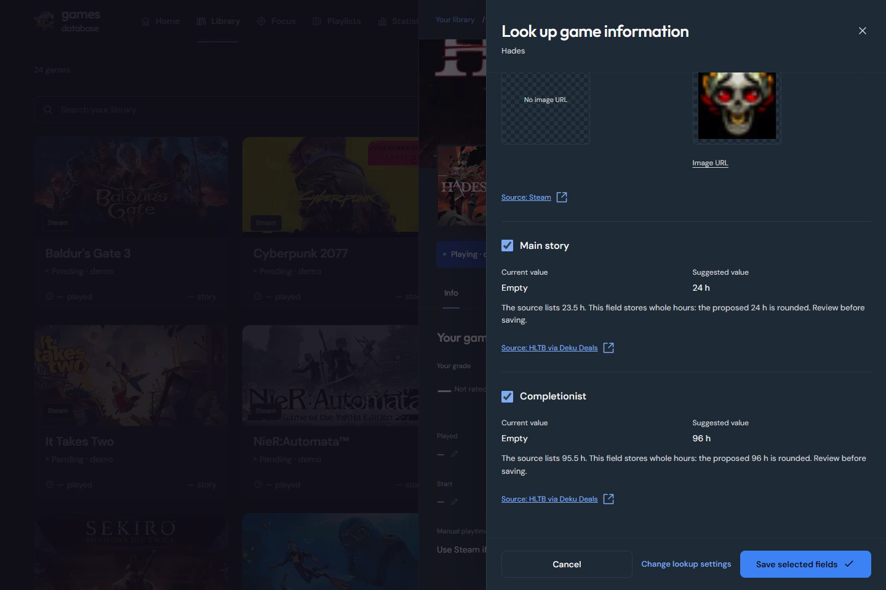
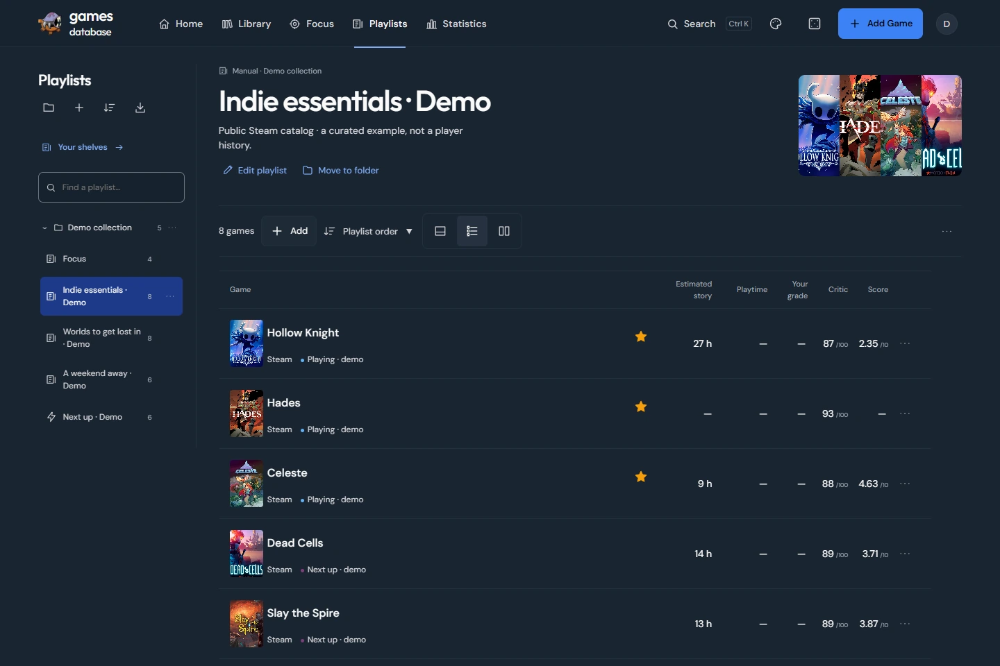
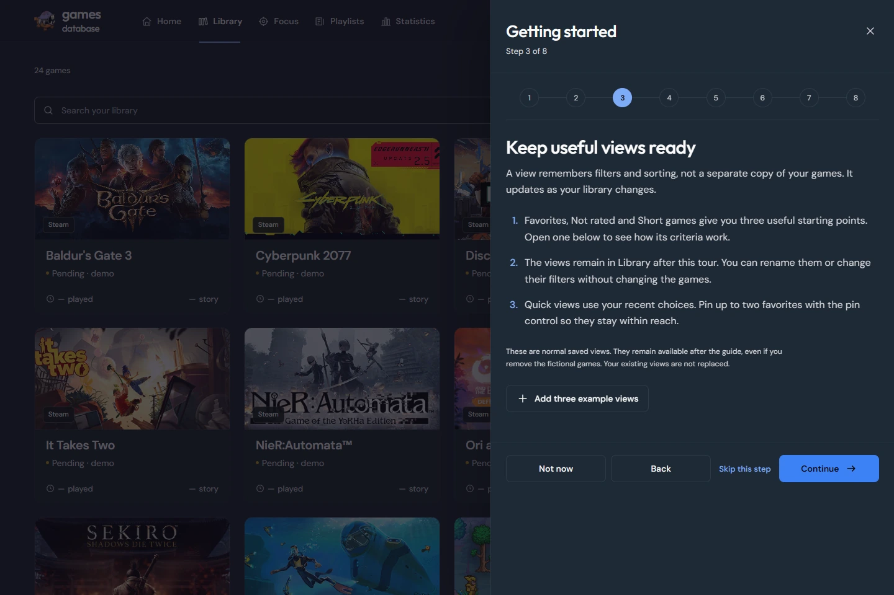

# Games Database API

[English](README.md) · [Español](README.es.md) · **Backend API** ·
[Web: English](https://github.com/David-H-Afonso/GamesDatabase.Front/blob/HEAD/README.md) /
[Español](https://github.com/David-H-Afonso/GamesDatabase.Front/blob/HEAD/README.es.md)

**The owned data and integration layer behind Games Database.**

An ASP.NET Core/.NET 10 API for personal game libraries: games, catalogs,
playlists, playthroughs, statistics, Steam, imports and recovery. Each account
owns its collection; clients do not choose another user's identity.

[Quick start](#requirements-and-quick-start) · [Practical walkthrough](#from-api-to-library) ·
[Contracts](#api-contracts) · [Architecture](DOCS/ARCHITECTURE.md)


> These are captures of the **paired web client**, not an API dashboard or a public
> player's account. The separate 24-game demo uses real Steam catalog facts/artwork;
> statuses, favorites and lists illustrate organization. No player unlocks, playtime,
> grades or play dates were copied or invented.
> [Sources and capture scope](DOCS/SCREENSHOTS.md).

**Source and releases:** this guide follows repository source. The verified
baseline before the 27 November follow-up was API **3.0.0** / Front **3.0.1**. Check
the exact tested version/SHA in [API releases](https://github.com/David-H-Afonso/GamesDatabase.Api/releases)
and [Web releases](https://github.com/David-H-Afonso/GamesDatabase.Front/releases).
An uncommitted clone may be newer than the latest image; source documentation does
not establish that an older image contains the later critic/date/pin or security changes.

## Capabilities

- JWT authentication, administrator/user management and owned catalogs/data.
- Game CRUD, sparse updates, literal Unicode name search, filters and saved views with two owned pin slots.
- Manual/automatic playlists, folders, capacity and atomic item/order operations.
- Revisioned Home/GOTY preferences and whole-collection statistics.
- Steam base/DLC achievement sets, preserved completion, explicit sync jobs and per-field date review.
- Independent artwork candidates and bounded SkiaSharp/WebP image thumbnails.
- Steam-first/Wikidata-second metadata plus attributed public Deku Deals duration estimates,
  with signed, expiring plans and exact source-hour/rounding disclosure.
- Optional onboarding, retained tutorial views, opt-in sample games and reviewed cleanup.
- Owned random discovery and stable daily recommendations at the UTC boundary.
- CSV/JSON/ZIP import/export and backup/network controls.

## From API to library

### 1. Start with an owned account and catalogs

Run the API on a deliberate empty/local database using the setup below, verify
`GET /health`, then open `/swagger` in Development. Sign in through the paired web
client or `POST /api/users/login`. Use the returned bearer session for subsequent
calls; never substitute an `X-User-Id` header or a foreign user's IDs.

Read `GET /api/gamestatus/active` and `GET /api/gameplatforms/active` to obtain **your**
catalog IDs. A manual creation can be as small as:

```http
POST /api/games
Authorization: Bearer <your-token>
Content-Type: application/json

{
  "name": "Portal 2",
  "statusId": 17,
  "creationRequestId": "1ca8ce95-7339-464b-a1b8-b3d5845ff845"
}
```

`17` is illustrative: replace it with an owned active status. Generate a UUID for
each new manual row; retry that exact row with the same UUID/payload, not a new game.
The web client's compact batch dialog keeps separate drafts and receipts.


### 2. Add catalog facts without importing player progress

Use the game's **Fill information automatically** action, or request
`POST /api/games/{id}/metadata/preview` with `overwrite`, `includeArtwork`,
`includeDurations`, `includeCritic`, `reviewVersion: 2` and an optional reviewed identity. Inspect `fields`, `matches` and
`notices`; then submit only selected field names plus the returned plan token to
`POST /api/games/{id}/metadata/apply`. A lookup never saves the game by itself.

Plans bind owner, game, its edit timestamp and a ten-minute expiry. Ordinary facts
use Steam/Wikidata; story/completionist proposals use attributed HLTB figures published
on public Deku Deals pages. `sourceHours` retains their precision, while the UI explains
the proposed integer-hour value. Neither estimates nor artwork are a player's progress.

Critic proposals preserve the actual provider: Steam-edition Metacritic, then
Metacritic/OpenCritic attributed by Deku, with listed-platform scope disclosed.
Replace refreshes populated groups; equal-value receipts do not invent timestamps
or history. New import/sync no longer names a calculated Steam user percentage
"SteamDB"; existing saved ratings are not rewritten. Explicit Front selection and
post-import batches use the same signed endpoints sequentially, with metadata-only
retry and no player sync or Steam-link changes. [Review v2 and compatibility](DOCS/METADATA_REVIEW.md).




Use `PUT /api/games/{id}` for ordinary sparse edits. Omitted fields stay unchanged;
Logo/Hero/Cover remain independent. Steam linkage is a separate explicit decision,
not a side effect of a public metadata lookup.

### 3. Reuse real playlists, views and Home sources

- `POST /api/playlists` creates manual or rule-based automatic lists; optional
  `maxLength` limits additions without deleting existing members.
- `POST /api/playlists/{id}/items` adds an owned game. Group/move/reorder operations
  are atomic. Focus is an ordinary manual playlist, not a second game table.
- Saved views retain filter/sort definitions. `POST /api/gameviews/{id}/use` records
  UTC use only; `POST /api/gameviews/{id}/pin` sets/unsets one of two owned slots.
  A third pin returns `409` rather than evicting an existing choice.
- `GET/PUT /api/home/config` and `POST /api/home/rows/resolve` configure/resolve rows
  from owned lists, views, filters, recommendations, Playing now or statistics.
  Removing a row never deletes its source; saves use the shared preference revision.



The client's Shelves uses those same manual lists. Daily discovery is owner-scoped
and stable at the shared UTC-day boundary; random discovery accepts the whole library
or the exact displayed-ID pool. It never silently widens an empty/stale selection.

### 4. Separate calendar records, estimates and accumulated hours

`GET /api/collection/statistics?year=2026&dateKind=finished` aggregates all owned games
and Replays. Change `dateKind=started` for starts. `GET /api/collection/games` opens
the corresponding paginated metric; GOTY is an explicit revisioned choice, not a
generated award. Developer statistics uses stored catalog facts.


Steam playtime is accumulated, not reconstructed sessions. Positive manual minutes
replace it or explicitly add; zero/empty uses Steam. Estimated story/completionist
hours do not declare completion. Steam base/DLC sets and strict all-achievements
completion have separate policies.

`GET /api/steam/date-suggestions?reviewVersion=2&timeZone=Europe%2FMadrid` offers
activity **references for empty fields**, not confirmed story start/end dates. The
user opts into each field; Apply uses the reviewed `expectedUpdatedAt` and returns
exact field receipts/history. Existing dates are retained and later sync cannot move
an accepted finish. Sentinels/future values are filtered before selecting events.
See [Steam dates](DOCS/STEAM_DATES.md) for timezones, fallback, partial results and old clients.

### 5. Offer guidance without taking ownership of user data

`GET /api/onboarding` reads progress/capabilities without creating data. The optional
guide can explicitly add six labelled fictional games and a sample playlist. Its
`POST /api/onboarding/views` creates useful **normal retained views**, independently
of accepting games. Cleanup reviews the actual batch/timestamps, preserves edited
games by default and never deletes normal views or unrelated playlist members.



Administrators can enable the guide when creating/editing users. Accounts retain
their own catalogs, views, playlists, pins and preferences; a provenance label is
informational, never permission to access or delete another account's records.

### 6. Sync and transfer only the intended scope

Link a Steam player only when wanted. `POST /api/steam/sync/jobs` starts/deduplicates
an explicit job; read its owned status instead of repeating POST. Per-game commits
survive process restart, but the in-memory job status does not. Public Store lookup
is separate and does not require someone's Steam key or private library.

Steam import and `PATCH /api/games/bulk` settings have separate acknowledgements.
Bulk reserves a short SQLite transaction before reading and validates owned catalog
IDs. No-op receipts do not forge edit timestamps. Contention returns sanitized
`503 databaseBusy` with `Retry-After: 1`, not a misleading invalid-input `400`.
Retain an already successful import and retry only unfinished settings if necessary.

Use CSV/JSON/ZIP endpoints according to their documented scopes. Pins, view use/order
and supported preferences are carried without displacing existing destination pins.
A full SQLite backup remains necessary for complete authentication/history/cache
recovery; never replace newer writes with an old export to make a test pass.

## Requirements and quick start

- **.NET 10 SDK**; Microsoft/EF packages 10.0.15, Swashbuckle 10.3.1, SkiaSharp 4.157.0.
- SQLite is supplied by EF Core. No separate database server is required.
- Node 22+ is needed only for repository version/release tooling, not the API runtime.

```sh
git clone https://github.com/David-H-Afonso/GamesDatabase.Api.git
cd GamesDatabase.Api
dotnet restore GamesDatabase.Api.sln
dotnet build GamesDatabase.Api.sln --configuration Release
dotnet test tests/GamesDatabase.Api.Tests/GamesDatabase.Api.Tests.csproj --configuration Release
```

Before running, configure a private signing key and an explicitly intended data
path. Follow [Get started](DOCS/GETTING_STARTED.md): existing data needs an agreed
consistent backup before startup, because pending migrations are applied.

```sh
dotnet run --project GamesDatabase.Api.csproj
```

Development profiles use HTTP on port 5011/HTTPS on port 7245 and expose `/swagger`.
Containers listen on port 8080. `/health` reports the running version.

## First installation and recovery

A genuinely empty SQLite database is initialized from the current EF model and
records the current migration baseline. A database with existing tables/history
is never treated as a fresh install: its pending migrations remain authoritative.
The first administrator and catalogs are seeded; example games are **not**.

The initial administrator has no password for local bootstrap. Set its password
before wider access. The guide is optional for newly created users and can be
reactivated without adding samples or changing their collection.

For an existing instance, retain its previous image by digest, take a WAL-safe
SQLite backup and test an isolated restoration before adoption. Migration Down
can remove new metadata and is not an automatic data-preserving rollback.
See [Deployment and recovery](DOCS/DEPLOYMENT.md).

## Configuration

| Name | Purpose |
| --- | --- |
| `GAMESDATABASE_DB_PATH` | Intended private SQLite file |
| `JWT_SECRET_KEY` | Strong private server signing key |
| `JWT_ISSUER` / `JWT_AUDIENCE` | Token issuer and audience |
| `JWT_EXPIRATION_MINUTES` / `JWT_REFRESH_TOKEN_EXPIRATION_DAYS` | Token lifetimes |
| `ExportSettings__DefaultExportPath` | Private export directory |
| `CorsSettings__AllowedOrigins__0` | Explicit browser origin |
| `ASPNETCORE_URLS` | Listening addresses/ports |
| `STEAM_API_KEY` | Server-only key for Steam player integrations |
| `HOUSEHOLD_REDIRECT_URIS` | Required exact callback allowlist, comma-separated; never a wildcard |
| `HOUSEHOLD_CLIENT_ID` | Client identifier when overriding the built-in Household client |

Never expose signing/Steam/network credentials to frontend variables. Local
`.env*`, Development settings, databases and exports do not belong in source or
container build contexts. Review actual TLS, origins, headers and exposure for
the deployment, not just Docker defaults.

The callback allowlist is validated on startup, including standalone installations.
Without Household, reserve a non-routable `.invalid` callback as explained in
[Get started](DOCS/GETTING_STARTED.md), rather than broadening redirect permissions.

## API contracts

- [Frontend API reference](DOCS/FRONTEND_API_DOCUMENTATION.md)
- [Collection, Home, statistics and discovery](DOCS/COLLECTION_EXPERIENCE.md)
- [Onboarding and reviewed metadata](DOCS/GUIDED_LIBRARY.md)
- [Steam achievement sets](DOCS/STEAM_ACHIEVEMENT_SETS.md)
- [Reviewed Steam date references and concurrent settings](DOCS/STEAM_DATES.md)
- [Runtime/image compatibility](DOCS/RUNTIME_NET10.md)
- [Household authorization](DOCS/HOUSEHOLD_INTEGRATION.md)

Home and GOTY share per-user revisions; conflicts return 409. Positive manual time
replaces Steam by default or adds to it with `manualPlaytimeIsAdditive=true`.
Zero/empty manual time uses Steam; raw sources remain separate. Completion policy is distinct from estimated
story/completionist hours. Replays preserve dated records, not invented sessions.

Random choice supports the full owned library or an exact displayed-ID pool.
View usage stores UTC `lastUsedAt` without editing its configuration. Optional
`creationRequestId` UUIDs make manual row retries idempotent while the record exists.

Metadata lookup does not save or sync a player. Apply accepts only reviewed fields
and rejects a stale game timestamp. Steam Store is availability-dependent; Wikidata
supplies CC0 facts. Attributed Deku Deals/HLTB estimates are optional, not guaranteed
playtimes; exact source hours and integer rounding are disclosed. Missing data is
never used to clear a field. See [Guided library](DOCS/GUIDED_LIBRARY.md) for bounds,
source selection, plan expiry and rate limits.

## Verification

```sh
dotnet restore GamesDatabase.Api.sln -p:NuGetAuditMode=all -p:NuGetAuditLevel=moderate -warnaserror:NU1902,NU1903,NU1904
dotnet build GamesDatabase.Api.sln --configuration Release --no-restore
dotnet test tests/GamesDatabase.Api.Tests/GamesDatabase.Api.Tests.csproj --configuration Release --no-build
node --test scripts/versioning/core.test.mjs scripts/versioning/release.test.mjs
node scripts/versioning/cli.mjs check
```

Tests use isolated `Testing` databases and synthetic provider responses; they
never require personal SQLite, sessions or a versioned `.env.test`. Windows tests
do not substitute for a Linux-image/native-encoder smoke test.

## Release and contribution

Front and API version independently, with a paired 3.0 product release. The
[version kit](scripts/versioning/README.md) checks prepared versions against each
commit; an explicit `Release-As: 3.0.0` records the owner-selected milestone.
Publication is gated on checks and the exact tested HEAD. Publishing is not deployment.

See [Contributing](CONTRIBUTING.md) for checks, migration review and safe reports.
Open reproducible API issues in [GitHub Issues](https://github.com/David-H-Afonso/GamesDatabase.Api/issues).
Sensitive disclosures follow [Security](SECURITY.md), not public issues.

## License and scope

The API retains its [GPL-3.0 license](LICENSE.md), also copied into the container.
SkiaSharp retains its MIT license; the application license does not replace
third-party notices. This release covers web/API, not Electron or a certification
of an unreviewed production hosting/recovery configuration.
