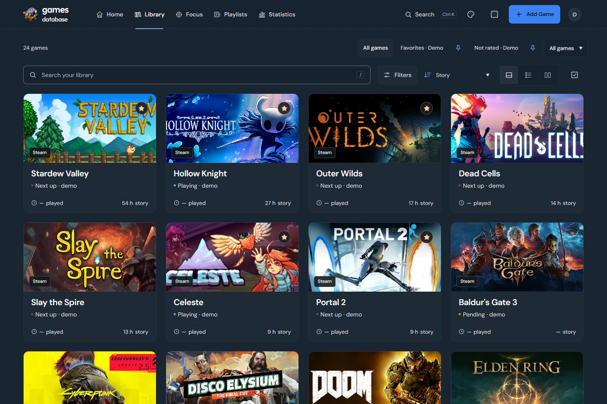
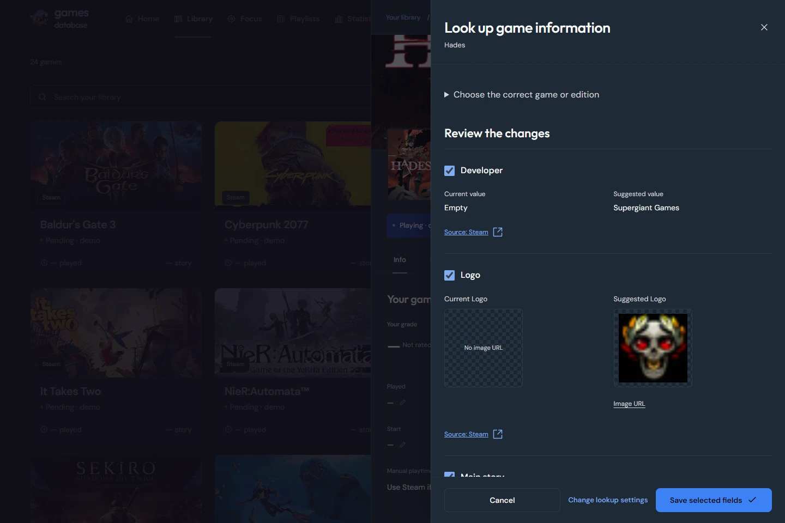

# Games Database API

[English](README.md) · [Español](README.es.md) · [Web client](https://github.com/David-H-Afonso/GamesDatabase.Front) · [Releases](https://github.com/David-H-Afonso/GamesDatabase.Api/releases)

The backend for Games Database, built with ASP.NET Core, EF Core and SQLite.
It stores each user's game library and provides the services used by the web client:
playlists, statistics, Steam integration, metadata and data transfers.

## Features

- JWT authentication, user administration and separate libraries and catalogs.
- Game search, filters, saved views, manual and automatic playlists, and folders.
- Home configuration, Focus, playthrough records and collection statistics.
- Steam import and achievement tracking, with reviewed date suggestions.
- Metadata from Steam and Wikidata, attributed critic ratings and HLTB estimates
  via Deku Deals. Background autofill jobs persist in SQLite and can be resumed.
- CSV, JSON and ZIP tools, backup configuration and optional Household integration.

<details>
<summary>See the web client</summary>





</details>

[Screenshot credits](DOCS/SCREENSHOTS.md).

## Run locally

Install the **.NET 10 SDK**. SQLite is included; a separate database server is not
needed. Node.js 22+ is only required for the repository's versioning tools.

Before starting the API, configure a private signing key, the database path and the
callback allowlist listed below. The [setup guide](DOCS/GETTING_STARTED.md) explains
the configuration and first sign-in.

```sh
git clone https://github.com/David-H-Afonso/GamesDatabase.Api.git
cd GamesDatabase.Api
dotnet restore GamesDatabase.Api.sln
dotnet build GamesDatabase.Api.sln --configuration Release
dotnet run --project GamesDatabase.Api.csproj
```

Development profiles use HTTP port **5011** and HTTPS port **7245**. Swagger is
available at `/swagger` in Development; `GET /health` reports the running version.
The container listens on port **8080**.

On a new installation, startup sets up the database and an initial administrator. Set that
account's password before sharing access, then create accounts for other users.
Each user can choose their interface language; an administrator can also assign it
when creating or editing an account.

Existing databases are migrated on startup. **Back up the SQLite database before
upgrading.** [Deployment and recovery](DOCS/DEPLOYMENT.md) covers backups and rollback.

## Configuration

| Variable | Purpose |
| --- | --- |
| `GAMESDATABASE_DB_PATH` | SQLite database file |
| `JWT_SECRET_KEY` | Private signing key, at least 32 characters |
| `JWT_ISSUER` / `JWT_AUDIENCE` | Token issuer and audience |
| `JWT_EXPIRATION_MINUTES` / `JWT_REFRESH_TOKEN_EXPIRATION_DAYS` | Session lifetimes |
| `CorsSettings__AllowedOrigins__0` | Allowed web-client origin |
| `ASPNETCORE_URLS` | Listening addresses and ports |
| `ExportSettings__DefaultExportPath` | Export directory |
| `STEAM_API_KEY` | Server-side key for Steam player features |
| `HOUSEHOLD_REDIRECT_URIS` | Comma-separated list of exact Household callback URLs |
| `HOUSEHOLD_CLIENT_ID` | Household client identifier, if overriding the default |

`HOUSEHOLD_REDIRECT_URIS` is required at startup, including standalone installations.
If Household is not used, configure a reserved `.invalid` callback as described in
the [setup guide](DOCS/GETTING_STARTED.md).

Keep signing keys, Steam keys and database files on the server. They do not belong
in frontend variables or source control.

## API overview

Sign in through `POST /api/users/login` and send the returned token as
`Authorization: Bearer <token>` with library requests. Collection endpoints use
the signed-in account's data.

| Area | Main routes |
| --- | --- |
| Users and sessions | `/api/users`, `/api/users/login`, `/api/users/refresh` |
| Library | `/api/games`, `/api/gameviews`, `/api/playlists` |
| Home and statistics | `/api/home/config`, `/api/collection/statistics` |
| Metadata review | `/api/games/{id}/metadata/preview`, `/api/games/{id}/metadata/apply` |
| Background autofill | `/api/metadata-autofill/jobs` |
| Steam | `/api/steam` |
| Getting-started guide | `/api/onboarding` |

Game updates can send only the fields that changed. Metadata review returns a
signed proposal; applying it requires the selected fields and the proposal token.
For payloads, response formats and examples, see the
[API reference](DOCS/FRONTEND_API_DOCUMENTATION.md) and
[metadata contracts](DOCS/METADATA_REVIEW.md).

## Development

```sh
dotnet test tests/GamesDatabase.Api.Tests/GamesDatabase.Api.Tests.csproj --configuration Release
```

Integration tests run the application against isolated SQLite databases with
synthetic provider responses. [Contributing](CONTRIBUTING.md) covers checks,
migrations and the versioning workflow.

## Documentation and support

| Guide | Contents |
| --- | --- |
| [Getting started](DOCS/GETTING_STARTED.md) | Configuration, first account and local startup |
| [Architecture](DOCS/ARCHITECTURE.md) | Services, persistence and application structure |
| [Account language](DOCS/ACCOUNT_LANGUAGE.md) | Admin defaults, user preferences and tutorial language |
| [Collection API](DOCS/COLLECTION_EXPERIENCE.md) | Home, playlists, statistics and discovery |
| [Metadata review](DOCS/METADATA_REVIEW.md) | Providers, signed proposals and persistent jobs |
| [Steam dates](DOCS/STEAM_DATES.md) | Suggested dates, timezones and field review |
| [Deployment and recovery](DOCS/DEPLOYMENT.md) | Containers, upgrades, backups and rollback |

For startup errors, check the signing-key and callback configuration first. For
browser connection errors, check the API URL and allowed origin. The
[deployment guide](DOCS/DEPLOYMENT.md) also covers image routing and storage.

Report bugs in [Issues](https://github.com/David-H-Afonso/GamesDatabase.Api/issues).
Security reports should follow [SECURITY.md](SECURITY.md).

## License

[GPL-3.0-or-later](LICENSE.md). Third-party libraries retain their own licenses;
game artwork belongs to its respective rights holders.
